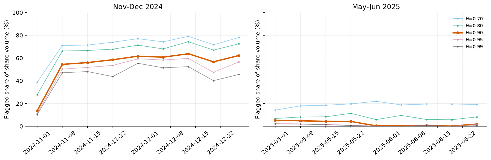

# ผลวิเคราะห์ครบ 18 สัปดาห์ — 23 ตุลาคม 2026

**Algorithm 1 ที่ θ=0.90 ติดธง 49.00% ของ share volume ใน พ.ย.–ธ.ค. 2024 เทียบกับ 2.50% ใน พ.ค.–มิ.ย. 2025** ความต่างยังอยู่ตลอดช่วง θ=0.70–0.99 แต่ตัวเลขจากสอง baseline weeks ไม่ควรใช้แทนทั้งสองช่วงเวลา

รันครบ 18 windows บนข้อมูลจริง **29,380,522 trades** และ **122 target days** ใช้ประวัติย้อนหลัง 30 วันต่อ window ผลทั้งหมดเป็น detector flags ไม่ใช่ ground truth ของ wash trading วิธีนับและคำสั่งรันอยู่ใน [README.md](README.md)

## ผลรวมรายช่วง

| ตัวชี้วัด | พ.ย.–ธ.ค. 2024 | พ.ค.–มิ.ย. 2025 |
|---|---:|---:|
| Windows / target days | 9 / 61 | 9 / 61 |
| Target trades | 19,111,285 | 10,269,237 |
| Share volume | 6,712.06 M | 2,667.56 M |
| Flagged share volume | 3,289.07 M | 66.82 M |
| **Flagged share fraction** | **49.00%** | **2.50%** |
| USDC volume | 1,979.45 M | 1,132.02 M |
| Flagged USDC volume | 784.43 M | 24.18 M |
| Flagged USDC fraction | 39.63% | 2.14% |
| ช่วง flagged fraction รายสัปดาห์ | 13.65–63.76% | 0.15–5.25% |

ผลรวมใช้เฉพาะ `in_target` ซึ่งไม่ทับกัน และถ่วงด้วย share volume จริง ไม่ได้เฉลี่ย percentages รายสัปดาห์หรือรวม lead-in ซ้ำ `flagged USDC volume` คือมูลค่าที่แลกเปลี่ยนใน trades ที่ติดธง ไม่ใช่กำไรหรือเงินเสียหาย

## ความต่างภายในช่วงเวลา

| เดือน (จัดด้วยวันเทรดจริง) | Target trades | Share volume | Flagged share fraction |
|---|---:|---:|---:|
| พ.ย. 2024 | 7,710,776 | 3,466.10 M | 37.69% |
| ธ.ค. 2024 | 11,400,509 | 3,245.96 M | 61.09% |
| พ.ค. 2025 | 5,047,430 | 1,336.20 M | 4.37% |
| มิ.ย. 2025 | 5,221,807 | 1,331.36 M | 0.64% |

- สัปดาห์เริ่ม 1 พ.ย. มี share volume 1,513.47 M แต่ถูกติดธง 13.65% ขณะที่อีกแปด windows ในช่วงเดียวกันอยู่ที่ 54.43–63.76% จึงทำให้ค่ารวมสองเดือนต่ำกว่าผล baseline ธ.ค. อย่างมีสาระ
- ฝั่งปี 2025 ลดจาก 5.25% ในสัปดาห์เริ่ม 1 พ.ค. เหลือ 0.41% ในสัปดาห์เริ่ม 29 พ.ค. แต่ไม่ได้ลดต่อเนื่องทุกสัปดาห์
- ช่วง 19–25 มิ.ย. ต่ำสุดที่ 0.15% ก่อนเพิ่มเป็น **1.95% ใน 26–30 มิ.ย.** ตลาด “Will Lewis Hamilton be the 2025 Drivers Champion?” มี flagged volume ประมาณ 3.85 M จากทั้งหมด 4.07 M ใน window สุดท้าย (ประมาณ 94.7%) จึงเป็นเคสเฉพาะตลาดที่ควรตรวจต่อ ไม่ใช่หลักฐานว่าตลาดทั้งหมดกลับมามี wash สูง

กราฟ volume ใน [02_daily_normalized_volume.png](figures/02_daily_normalized_volume.png) ใช้หน่วยต่อวัน เพราะ windows เริ่ม 27 ธ.ค. และ 26 มิ.ย. มีเพียง 5 วัน

## ความไวต่อ threshold

| θ | พ.ย.–ธ.ค. 2024 | พ.ค.–มิ.ย. 2025 |
|---|---:|---:|
| 0.70 | 66.50% | 18.83% |
| 0.80 | 59.94% | 7.51% |
| 0.90 | 49.00% | 2.50% |
| 0.95 | 44.82% | 1.13% |
| 0.99 | 39.46% | 0.87% |

ความต่างระหว่างสองช่วงยังอยู่ทุก threshold ที่ทดลอง แต่ปริมาณที่ถูกติดธงเปลี่ยนมากตามเกณฑ์ จึงควรรายงาน sensitivity คู่กับ θ หลัก ไม่เลือก threshold หลังเห็นผลเพื่อให้ตัวเลขดูดี

เคส “Will Donald Trump be inaugurated?” ถูกติดธงที่ θ=0.90 ตั้งแต่ 0.02% ใน window เริ่ม 1 พ.ย. ถึงสูงสุด 87.41% ใน window เริ่ม 6 ธ.ค. แต่ที่ θ=0.99 เหลือสูงสุดเพียง 14.14% ใน windows ที่วิเคราะห์ เคสนี้ยังแสดงความไวต่อ threshold เมื่อดูตลอดช่วง และยังไม่ยืนยัน false positive ตลาดนี้มี flagged volume รวมประมาณ 187.19 M shares (อันดับหนึ่งของช่วง พ.ย.–ธ.ค.) จึงมีความสำคัญต่อการตรวจเชิงคุณภาพ

## โปรไฟล์ของกระเป๋าที่ติดธง

| ค่าเฉลี่ยถ่วง target endpoint volume | พ.ย.–ธ.ค. flagged / unflagged | พ.ค.–มิ.ย. flagged / unflagged |
|---|---:|---:|
| Top-1 partner share | 42.49% / 18.92% | 31.27% / 19.83% |
| Top-2 partner share | 55.54% / 28.51% | 56.77% / 30.00% |

กลุ่มติดธงมี volume กระจุกกับคู่เทรดมากกว่าทั้งสองช่วง จึงสอดคล้องกับรูปแบบที่ detector ออกแบบให้จับ แต่ลักษณะนี้ไม่ใช่ validation อิสระ เพราะ score ใช้ความสัมพันธ์คู่เทรดอยู่แล้ว ดู [03_partner_concentration.png](figures/03_partner_concentration.png)

ใน พ.ย.–ธ.ค. 83.22% ของ volume ฝั่งกระเป๋าที่ติดธงมาจากกระเป๋าที่มี volume อย่างน้อย 90% กับคู่เทรดที่ติดธงเช่นกัน เทียบกับ 59.70% ใน พ.ค.–มิ.ย. ทั้งสองค่าถ่วงด้วย volume และยังไม่พิสูจน์วงแหวนหรือ chip dumping

สำหรับกระเป๋าที่ active ใน windows ติดกัน พบสัดส่วนเปลี่ยน flag 5.74–15.85% ใน พ.ย.–ธ.ค. และ 1.95–4.93% ใน พ.ค.–มิ.ย. คะแนนใช้ประวัติแบบเลื่อนช่วง จึงไม่ควรมอง label เป็นคุณสมบัติถาวรของ wallet หรือถือว่าการเปลี่ยน label ยืนยันการเปลี่ยนพฤติกรรมจริง ดู `adjacent_wallet_transitions.csv`

## ราคาและหมวดตลาด

| สัดส่วนของ flagged share volume | พ.ย.–ธ.ค. | พ.ค.–มิ.ย. |
|---|---:|---:|
| ราคา < 0.02 USDC | 72.59% | 37.02% |
| หมวด Sports ตาม keyword heuristic | 48.77% | 18.51% |

ข้อค้นพบเรื่องราคาต่ำยังเห็นเมื่อขยายจาก baseline เป็นช่วงเต็ม ส่วนหมวด Sports เป็นหมวดที่มี flagged volume มากที่สุดใน พ.ย.–ธ.ค. แต่ไม่ได้เกินครึ่งของ flagged volume ทั้งหมด ต่างจากภาพใน baseline ธ.ค. สัปดาห์เดียว

ใน พ.ค.–มิ.ย. หมวด Other มี flagged volume 53.19% ซึ่งรวมภาพยนตร์และกีฬาที่ keyword rules จับชื่อไม่ครบ เช่นตลาด Lewis Hamilton ข้างต้น ดังนั้นไม่ควรตีความ Other ว่าเป็นประเภทตลาดที่แท้จริง หรือสรุปจากชื่อหมวดนี้โดยไม่ตรวจรายการตลาด ดู [04_category_mix.png](figures/04_category_mix.png) และ `top_flagged_markets.csv`

## การตรวจผลและสิ่งที่ยังสรุปไม่ได้

ทุก window ผ่านการตรวจ convergence, finite scores ใน [0,1], weighted score conservation, counts/volume/date boundaries เทียบ extraction เดิม, flags ตรงกับ score และ endpoint volume ÷ 2 ตรงกับ trade volume Market curves ทั้งหมดไม่เพิ่มเมื่อ θ สูงขึ้นและตรงกับการรวม trade scores โดยตรงภายในความคลาดเคลื่อนจากการปัด 4 ตำแหน่ง ตรวจว่ามี 122 วันไม่ซ้ำและผลรวมรายวัน/หมวด/period ตรงกันแล้ว ดู `04_Evaluation/premise_test/results/weekly/validation.json`

Integration test ด้วยคำตอบที่ทราบล่วงหน้าผ่าน ทั้งการนับ volume, shortened window, metadata ซ้ำ และความเท่ากันระหว่าง reused scores กับ scoring ใหม่ ผล baseline เดิมไม่ได้ถูกเขียนทับ

ผลนี้ขยายความครอบคลุมเวลาและยืนยันความต่างเชิงพรรณนาเท่านั้น ยังไม่มี real-world ground truth, starting positions ก่อน lead-in ยังไม่ทราบ และ `user_position` snapshot ไม่ตรงช่วงเวลา Synthetic evaluation เดิมยังมี AP/precision@k ต่ำและไม่ควรใช้แทน precision ของ wash trading จริง รายงานข้อจำกัดเหล่านี้ควบคู่กับผล 49.00% vs 2.50%
